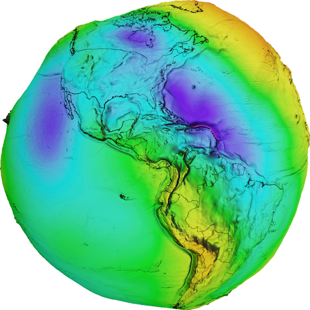
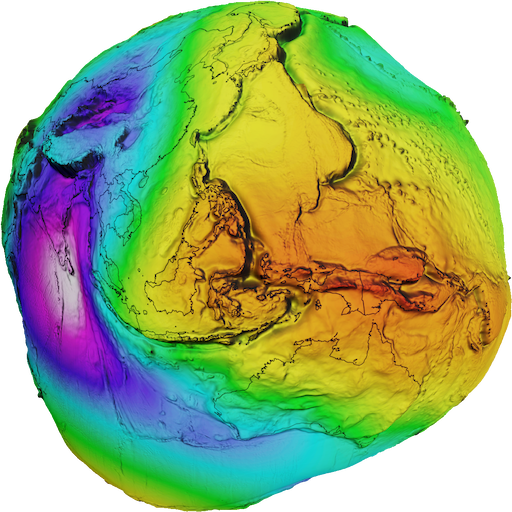
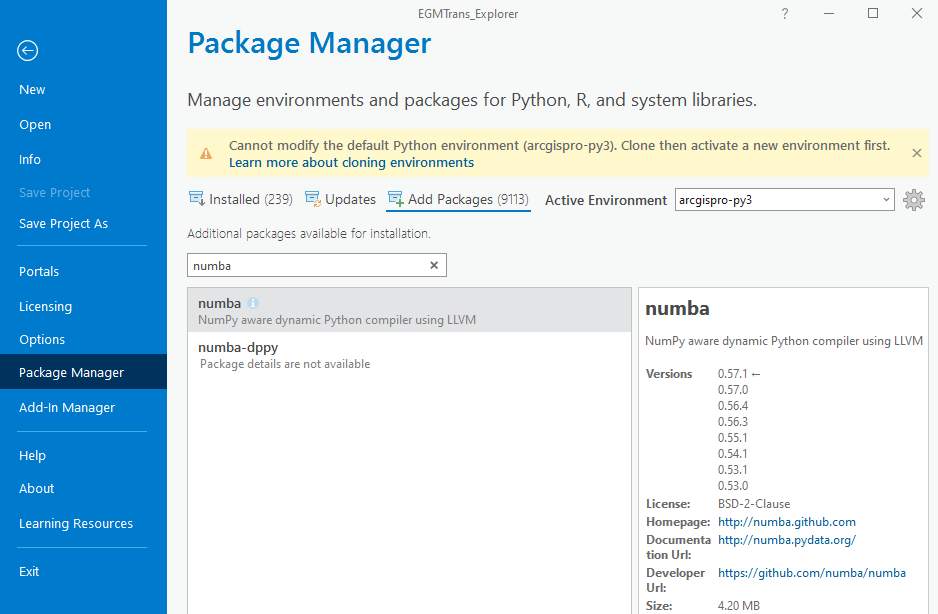
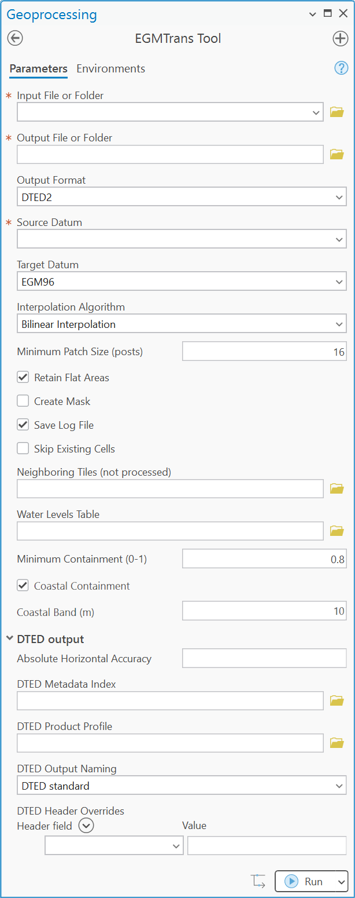
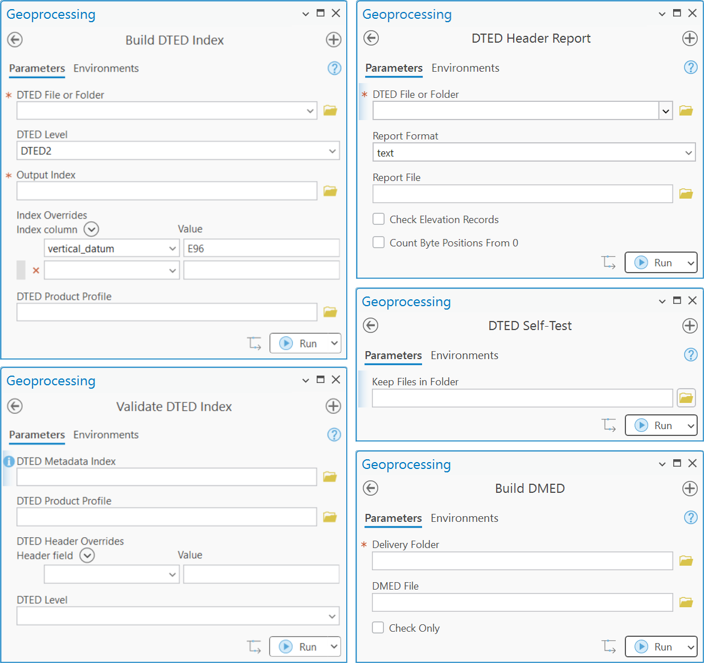

<br clear="all">

# EGMTrans

<p align="left">
  
  
</p>

EGMTrans makes standard DTED deliveries from GeoTIFF elevation tiles on the whole-degree lattice, such as TanDEM-X tiles, and transforms the vertical datum of GeoTIFF and DTED files between the WGS 84 ellipsoid, EGM96 and EGM2008. DTED is written in EGM96 only, as MIL-PRF-89020B requires, into the standard `DTED/E006/N49.dt2` tree, with water bodies kept level across tiles and the same bytes on every computer.

A DTED header carries what no raster holds: the producer, the edition, the dates, the security markings, the accuracies and the datum codes. EGMTrans takes them from a metadata index (one row per cell) and a product profile (the constants of the product, from a template), and stops before writing when a required field has no source. The quickest way to a correct index is to build it from DTED cells you already have with Build DTED Index, overriding in the Index Overrides what the new product's specification changes (`vertical_datum`, `producer_code`, `dsi_producer_text`), and to check it with Validate DTED Index before the first run.

It runs as an ArcGIS Pro toolbox of six tools, the EGMTrans Tool and five DTED tools (ArcGIS Pro 3.7 or later, Python 3.13), or on the command line, on Windows, Linux and macOS, online or on a closed network.

## Getting started

### Quick start in ArcGIS Pro

1. Unzip the release anywhere ArcGIS Pro can read, for example `C:\Tools\EGMTrans`.
2. Put the two one-arc-minute geoid grids in the `datums` folder: `us_nga_egm96_1.tif` and `us_nga_egm08_1.tif`, from the [geoid grid release](https://github.com/ngageoint/EGMTrans/releases/tag/datum-grids-v1). On a closed network, copy them over by hand and check their SHA-256 against `datums/README.md` (see [Offline setup](#offline-setup)); the toolbox downloads them itself when the computer is online.
3. Give ArcGIS Pro a Python environment with Numba. The default environment `arcgispro-py3` cannot take packages, and without Numba a one-degree tile takes tens of minutes instead of about a minute (the bytes are the same). In Project > Package Manager: under Environments, clone `arcgispro-py3` (the copy takes several minutes); make the clone the active environment; open Add Packages, search for `numba` and click Install (upper right); then **restart ArcGIS Pro**, because the running Pro keeps the environment it started with and the tool would report "Numba is not available". On a closed network, see [Offline setup](#offline-setup).

   **ArcGIS Pro Package Manager**  
   

4. In the Catalog pane, right-click Toolboxes, choose Add Toolbox, and pick `arcgis\EGMTransToolbox.pyt`. Nothing is installed: the toolbox finds the package in `src` beside it.
5. Run **DTED Self-Test**. It converts two built-in tiles and compares the bytes with the pinned reference, so you know this computer reproduces the reference before a real run.
6. Run **EGMTrans Tool**: the input tile or folder, the output folder, the Output Format (DTED2 by default), the Source Datum of your tiles, and, in the DTED output group, the product profile and the metadata index. The Target Datum is EGM96; the dialog shows the header plan of the first cell before you run. If you have no index yet, see [The DTED tools](#the-dted-tools): **Build DTED Index** makes one from a folder of DTED files, and **Validate DTED Index** checks an edited one.

### Quick start on the command line

```bash
conda env create -f environment.yml      # GDAL from conda-forge; pip cannot install it reliably on Windows
conda activate egmtrans
pip install -e .                         # or "pip install -e .[core]" without Numba
python download_grids.py                 # the five geoid grids, about 1.3 GB; see Offline setup for two

egmtrans -i tiles -o delivery -s EGM2008 -t EGM96 -y --dted-level 2 \
  --dted-index collection.gpkg --dted-profile product.toml
egmtrans dmed delivery
```

`python EGMTrans.py` runs the same command line without installing. `egmtrans --help` lists every option; the subcommands `dted-header`, `dted-index`, `dted-selftest` and `dmed` have their own `--help` (see [The DTED tools](#the-dted-tools)).

### Offline setup

Everything below is what a closed network needs; nothing else reaches the internet.

- **The two geoid grids** `us_nga_egm96_1.tif` and `us_nga_egm08_1.tif` go in `datums/`. Copy them from the [release page](https://github.com/ngageoint/EGMTrans/releases/tag/datum-grids-v1) on a connected computer and compare their SHA-256 with the values in `datums/README.md` (`certutil -hashfile <file> SHA256` on Windows, `sha256sum` elsewhere). The tool and the toolbox verify the hashes before a DTED cell is written and download only the grids a run needs, so these two are enough for every transform. The three other grids serve the Explorer map only. `python download_grids.py` fetches all five and needs the internet.
- **Numba in ArcGIS Pro.** Step 3 of the quick start installs it from Esri's channel, which needs the internet. On a closed network, clone the environment the same way, carry the `numba` and `llvmlite` packages for the clone's Python version over, install them with `conda install --offline`, and restart ArcGIS Pro; the procedure is checked on ArcGIS Pro 3.7. Without Numba a one-degree 0.4-arc-second tile takes tens of minutes instead of about a minute; the bytes are the same.
- **The Python package.** `pip install -e .` fetches setuptools when the environment lacks it; `pip install --no-build-isolation -e .` with setuptools already present stays offline, and `python EGMTrans.py` needs no installation at all.
- **Docker.** The image builds online only (it downloads the grids and the conda packages); move it with `docker save` and `docker load`.
- **The Explorer** map's OpenStreetMap basemap and its locators need the internet; the geoid layers do not.

## The EGMTrans Tool

**The EGMTrans Tool in ArcGIS Pro**  


The tool has three uses. **GeoTIFF to DTED**, its main purpose: every whole one-degree cell a tile covers becomes one DTED cell in the standard tree, its header filled from the index and the profile, verified before it gets its name. **GeoTIFF to GeoTIFF**: the file becomes a Cloud Optimized GeoTIFF with a compound CRS in the target datum. **DTED to DTED**: the file keeps its name and level and gets its header rewritten. The Output Format decides (DTED2 by default; DTED is written in EGM96 only), and in a folder run the water bodies that cross tile edges get one level over the whole run.

### Recipes

**Make DTED from GeoTIFF with an index and a profile, then the DMED.** The tiles must lie on the whole-degree lattice (TanDEM-X and similar products). Every whole one-degree cell a tile covers becomes one file under `DTED/<lon>/<lat>.dt2`; the index row and the profile fill its header. Copy `docs/dted_profile_template.toml`, replace every `<...>` placeholder with the product's own values (a profile with a placeholder is refused), and build the index with [Build DTED Index](#build-dted-index) or export it (see [docs/dted_index.md](docs/dted_index.md)). Run the self-test first, and the DMED last, once every cell of the delivery is there.

```bash
egmtrans dted-selftest
egmtrans -i tiles -o delivery -s EGM2008 -t EGM96 -y -m True --dted-level 2 \
  --dted-index collection.gpkg --dted-profile product.toml
egmtrans dted-header delivery/DTED/E006/N49.dt2 --check-data
egmtrans dmed delivery
```

A single tile to a single cell needs no level: `egmtrans -i N49E006_DEM.tif -o N49.dt2 -s EGM2008 -t EGM96 -y --dted-profile product.toml`. A run that was cancelled or failed is continued with `--skip-existing`; the cells already written and verified are left alone.

**Transform a tile or a folder.** A GeoTIFF becomes a Cloud Optimized GeoTIFF with a compound CRS; a DTED file keeps its name and level and gets its header rewritten. A folder is searched recursively, its folders and auxiliary files are mirrored, and the water bodies that cross tile edges get one level over the whole run.

```bash
egmtrans -i tile.tif -o tile_egm96.tif -s EGM2008 -t EGM96
egmtrans -i cells_e08 -o cells_e96 -s EGM2008 -t EGM96 -y
```

**Neighbors and water levels.** Tiles that share a lake or river belong in one run. When the neighbors are produced in another run, give them as `--context FOLDER` (Neighboring Tiles in ArcGIS Pro): they are analyzed with the input but never written. Or export the levels of an earlier run over the larger area with `--export-water-levels levels.csv` and pass them to the later runs with `--water-levels levels.csv`, so the level does not depend on the order of production. See [docs/water_bodies.md](docs/water_bodies.md).

```bash
egmtrans -i cell_17 -o out_17 -s EGM2008 -t EGM96 -y --context delivery/cell_16 --context delivery/cell_18 \
  --export-water-levels cell_17_levels.csv
egmtrans -i cell_18 -o out_18 -s EGM2008 -t EGM96 -y --water-levels cell_17_levels.csv
```

**Run in a container.** The Dockerfile builds an image with GDAL, NumPy, SciPy, Numba, the two one-arc-minute grids (checked against their pinned SHA-256) and precompiled kernels; a container needs no network at run time.

```bash
docker build -t egmtrans .
docker run --rm --network none --user "$(id -u):$(id -g)" -v "$PWD:/data" egmtrans \
  -i tiles -o delivery -s EGM2008 -t EGM96 -y --dted-level 2 --dted-profile product.toml
```

Pass `-y`: a container has no terminal to answer a prompt, so without it EGMTrans stops with exit code 2. For large batches, run one container per region with `NUMBA_NUM_THREADS=1` and as many containers as cores, split along boundaries that no lake or river crosses. `docker/smoke_test.sh` builds the image and checks a GeoTIFF transform, a DTED transform, a delivery with its DMED and the refusal of an EGM2008 target, with the network off; `benchmarks/README.md` describes the timing script.

### Parameters

| ArcGIS Pro | Command line | What it does |
|---|---|---|
| Input File or Folder | `-i` | A DTED or GeoTIFF file, or a folder of them, searched recursively. Files that are not DEMs are skipped; files that cannot be read are reported and counted. |
| Output File or Folder | `-o` | The output file (`.tif`, `.tiff`, `.dt0`, `.dt1`, `.dt2`) or folder; may not lie inside the input folder; a drive or share root is fine. |
| Output Format | `--dted-level N` | DTED2 (default), DTED1, DTED0 or GeoTIFF. A DTED input must be at the level given. For a DTED format the Target Datum and the Interpolation Algorithm offer EGM96 and bilinear only and the DTED parameters apply. |
| Source Datum | `-s` | WGS84, EGM96 or EGM2008: state what your tiles are in. Every input's header or CRS is compared with it before anything is written. |
| Target Datum | `-t` | EGM96 for DTED; WGS84, EGM96 or EGM2008 for GeoTIFF. |
| Interpolation Algorithm | `-a` | bilinear (default; the only one for DTED), spline, delaunay, or proj on the command line. See [docs/algorithms.md](docs/algorithms.md). |
| Minimum Patch Size (posts) | `-p` | The least number of posts of a flat area that counts as a water body; default 16. |
| Retain Flat Areas | `-f` | Keep the ocean at 0 and every water body at one level across the run; on by default. Off, or with WGS84 as either datum, nothing is leveled and the three water options below are ignored. |
| Create Mask | `-m` | A mask beside each output: 1 for the ocean, one value per water body. Beside a DTED cell it is named for the source tile. |
| Save Log File | `-l` | The log, beside a single output or inside the output folder; appended on a rerun, UTF-8. |
| Skip Existing Cells | `--skip-existing` | Leave outputs that already exist and verify alone, so a cancelled or failed run can be continued; their inputs are still analyzed, so the water levels match an uninterrupted run. Otherwise existing outputs are listed before they are replaced. |
| Neighboring Tiles (not processed) | `--context FOLDER` | Additional tiles in the source datum that constrain the run: analyzed, never written. May be repeated on the command line. |
| Water Levels Table | `--water-levels FILE` | A table from an earlier run's `--export-water-levels`. |
| Minimum Containment (0-1) | `-c` | The share of a flat area's boundary that must lie above it for the area to be water; default 0.8. |
| Absolute Horizontal Accuracy | `--abs_horiz_accuracy` | A default CE90 for DTED headers that have none. |
| DTED Metadata Index | `--dted-index FILE` | GeoPackage or GeoParquet; the cell's row fills its header. |
| DTED Product Profile | `--dted-profile FILE` | TOML of the product's header constants, from the template. |
| DTED Output Naming, Naming Template | `--dted-naming` | DTED standard (`DTED/E006/N49.dt2`, default), Cell name (`N49E006.dt2`), Input name (`stem`), or a template with `{stem}`, `{dir}`, `{cell}`, `{lat}`, `{lon}`, `{level}`. |
| DTED Header Overrides | `--dted-set FIELD=VALUE` | One value for every cell of the run, over the index and the profile. |
| DTED Header Summary | | Read only: which header fields come from where, and what is still missing. |
| | `-y` | Answer the prompts (a datum the headers contradict, the header plan) for unattended runs. |
| | `--export-water-levels FILE` | Write the levels of the water bodies that touch a tile edge. |

### DTED output

- DTED is written in EGM96 only (MIL-PRF-89020B 3.2.2); an EGM2008 or WGS84 target is refused before anything runs. EGM2008 (`E08`) DTED is read as input.
- Cells made from GeoTIFF land in the standard tree, `DTED/E006/N49.dt2`, with masks beside them. An output folder named `DTED` gets no second root. `--dted-naming stem` gives the layout of earlier versions.
- Every cell is written under a scratch name, verified (header, records, checksums, the level its name claims, GDAL reading it back) and renamed; the log holds its size and SHA-256.
- A DTED0 cell comes with its `.avg`, `.min` and `.max` companion files (3.9.3). The DMED volume file (3.9.5) is written by `egmtrans dmed` ([Build DMED](#build-dmed)) once the delivery is complete. Not produced: `onc.dir`, the gazetteer and `Read.me`.
- A DTED input is transformed at its own level and must match the level given; DTED-to-DTED runs mirror the input tree.
- Only bilinear interpolation is accepted for DTED, so that tiles edge-match whatever their extent.

### Constraints

The following are refused: formats other than GeoTIFF and DTED; a horizontal datum other than WGS 84; a GeoTIFF that is not on the whole-degree lattice, has a scale or offset, covers no whole cell, or holds undeclared voids (-9999, or values at or below -12,000 m without a NoData value), when DTED is made from it; a DTED cell without a profile or index to fill its header; a DTED input at another level than the one given; an interpolation algorithm other than bilinear for DTED; GeoTIFFs with more than one band (ignored in a folder); an output folder inside the input folder; a profile that still holds template placeholders; a date outside 1980-2079 in a header field.

You are asked before the run goes on when the source and target datums are the same for a GeoTIFF (the file is rewritten as an optimized copy with the compound CRS), and when an input's header or CRS declares another vertical datum than the source datum you gave (the files are listed; `-y` proceeds, ArcGIS Pro warns and proceeds).

### Exit codes

`0` success, `1` a transformation failed or the run was cancelled, `2` an argument or path error, a DTED target other than EGM96, or a prompt that could not be answered.

## The DTED tools

Five tools prepare and check a delivery. Each is also a subcommand of `egmtrans` with its own `--help`: `dted-selftest`, `dted-index build`, `dted-index validate`, `dted-header` and `dmed`. Reports go to stdout or `--out` and messages to stderr, so a report can be piped; the exit code is `0` when clean, `1` on findings or failures, `2` on a usage error. The parameters, messages and exit codes of every tool are in [docs/dted_tools.md](docs/dted_tools.md); the index and the profile are explained in [docs/dted_index.md](docs/dted_index.md).

**The DTED tools in ArcGIS Pro**  


### DTED Self-Test

Converts two built-in tiles to DTED2, DTED1 and DTED0 and compares the bytes with the pinned reference, so you know this computer reproduces the reference before a real run; its first line names the versions in play, what two producers compare first when their bytes differ. Run it after installing or updating EGMTrans, and whenever ArcGIS Pro, GDAL or numpy changes.

```bash
egmtrans dted-selftest
```

### Build DTED Index

The headers of the DTED files under a folder become one index row per cell, subregions included, every column written; DTED Level (`--level`) picks the level when the folder holds several. An Index Overrides row (`--set` on the command line) writes one value in every row: `vertical_datum = E96` records the datum code a transformed delivery will carry, and `producer_code` and `dsi_producer_text` stamp the new product's producer when it is not the one the cells came from. A file that cannot be read is reported and gets no row, the index is still written for the other cells, and the command exits 1. The messages end with where each required header field comes from and what nothing supplies yet.

```bash
egmtrans dted-index build --out collection.gpkg --from-dted delivery --level 2 --set vertical_datum=E96
```

### Validate DTED Index

Checks the index as a run would see it, with the profile and the header overrides the run will use: two rows for one cell, bad cell ids, values out of range, the level, the subregions, producer codes against FIPS 10-4, rows that disagree with a profile constant, and whether every required header field has a source. Run it after every edit of the index, before the EGMTrans Tool reads it.

```bash
egmtrans dted-index validate collection.gpkg --profile product.toml --level 2 --dted-set compilation_date=today
```

### DTED Header Report

Prints every field of a header with its byte positions and the specification's findings; Check Elevation Records (`--check-data`) checks the records too; Report Format and Report File (`--format json|csv|md`, `--out`) write a report. A folder is searched for DTED files, and the run ends with a summary line.

```bash
egmtrans dted-header delivery/DTED/E006/N49.dt2 --check-data
egmtrans dted-header delivery --format csv --out headers.csv
```

### Build DMED

Writes the DMED volume file (MIL-PRF-89020B 3.9.5) beside the `DTED` folder of a finished delivery, once every cell is there; Check Only (`--check`) compares an existing DMED with the cells instead of writing. Rerun it after cells are added or replaced.

```bash
egmtrans dmed delivery
```

## Troubleshooting

- **GDAL build failure on Windows** (`Microsoft Visual C++ 14.0 or greater is required`): `pip` found no GDAL wheel for your Python. Use the conda environment, or install GDAL from OSGeo4W before `pip install`.
- **EPSG lookups fail** (`proj_create_from_database: Open of .../share/proj failed`): PROJ 9.9 lists the user's own PROJ directory first, and when it exists without a `proj.db` every lookup fails. EGMTrans points GDAL at the directory that holds the database; if the error remains, set `PROJ_DATA` to it, for example `<env>/share/proj`.
- **The toolbox shows the previous version** after an upgrade: restart ArcGIS Pro; the toolbox reloads its shim but not the package, and it warns when the two versions differ.
- **Red "!" icons on the Explorer's geoid layers**: the project was opened before the grids were in `datums/`; close and reopen it.
- **A run in ArcGIS Pro says little** for a large batch: the messages pane shows one line per cell, the water-body counts and the warnings; the log file keeps the detail, including the tables at the end of pass 1 of the water bodies that span tiles and of those that touch the run boundary.
- **A lake that spans tiles is not named**: look at the end of pass 1 in the log. One table lists the water bodies that span more than one tile with the tiles and sides each part touches; the other lists the bodies that touch an edge with no neighbor in the run. `*` marks such a side, (context) a tile analyzed but not written, (finished) a tile written by an earlier run and skipped.
- **The run says Numba is not available** although it is installed: ArcGIS Pro was not restarted after the install, or another environment is active (Package Manager shows the active one).

## More

- [docs/dted_tools.md](docs/dted_tools.md): the five DTED tools, their parameters with the command-line equivalents, their messages and exit codes.
- [docs/dted_index.md](docs/dted_index.md): the metadata index, the product profile, header precedence, the producer code, building an index from a delivery, DTED-to-DTED headers and the header report.
- [docs/water_bodies.md](docs/water_bodies.md): flattening, containment, enclosed low spots, seams, neighboring tiles and water-level tables.
- [docs/algorithms.md](docs/algorithms.md): the interpolation algorithms, why DTED takes bilinear only, and the geoid grids.
- [docs/determinism.md](docs/determinism.md): how a DTED cell is made from a GeoTIFF, the companion files, and the same bytes on every computer.
- [docs/explorer.md](docs/explorer.md): the EGMTrans Explorer map for ArcGIS Pro and QGIS.
- [CHANGELOG.md](CHANGELOG.md), [CONTRIBUTING.md](CONTRIBUTING.md), [SECURITY.md](SECURITY.md). The version is defined in `src/egmtrans/_version.py`. MIT license, see [LICENSE](LICENSE).

## Contact

**National Geospatial-Intelligence Agency (NGA)**  
_Office of Geomatics & Targeting, Elevation Division_  
3838 Vogel Road  
Mail Stop L-041  
Arnold, MO 63010  
+1 314-676-9146  
<terrain@nga.mil>
